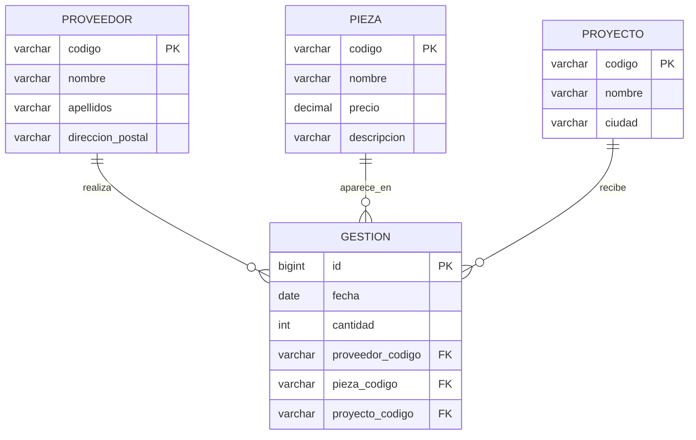

# Gestión de proyectos

Este proyecto es una aplicación Java para gestionar proveedores, piezas, proyectos y los suministros que relacionan a estas tres entidades. Está hecha con Hibernate y MariaDB, y se utiliza desde un menú de consola.

## 1. Qué hace la aplicación

Desde el menú principal se puede entrar en los siguientes apartados:

- **Proveedores:** registrar, modificar, eliminar, buscar por código, buscar por nombre, buscar por dirección y mostrar todos.
- **Piezas:** registrar, modificar, eliminar, buscar por código, buscar por nombre y mostrar todas.
- **Proyectos:** registrar, modificar, eliminar, buscar por código, buscar por nombre, buscar por ciudad y mostrar todos.
- **Suministros:** registrar, modificar y eliminar suministros; buscar por ID, proveedor, pieza o proyecto; y mostrar todos.

Cada suministro guarda la fecha, la cantidad y las referencias al proveedor, la pieza y el proyecto correspondientes.

Los servicios validan los datos antes de guardarlos. Por ejemplo, se comprueban los campos obligatorios, los límites de longitud, los códigos duplicados y que la cantidad de un suministro sea positiva. También se evita eliminar proveedores, piezas o proyectos que tengan suministros asociados.

Las búsquedas avanzadas que aparecen en el enunciado (por ejemplo, búsqueda por apellidos, intervalo de precios o piezas suministradas por proveedor) todavía no están implementadas en esta versión.

## 2. Requisitos para ejecutarlo

Hace falta tener instalado:

- Java 17 o superior.
- IntelliJ IDEA (el proyecto está preparado para abrirse como proyecto Maven).
- XAMPP o MariaDB instalado y en ejecución.
- Maven, que se puede utilizar desde la ventana Maven de IntelliJ IDEA.

La aplicación utiliza estas tecnologías y librerías principales:

- Hibernate ORM 6.6.59.Final.
- MariaDB JDBC 3.5.11.
- JUnit Jupiter 5.12.2 y Mockito 5.17.0 para las pruebas.
- SLF4J 2.0.17 y Logback 1.5.18 para los registros.

Las dependencias se descargan a través de Maven usando el archivo `pom.xml`.

## 3. Preparar la base de datos

1. Iniciar MySQL/MariaDB desde XAMPP.
2. Abrir phpMyAdmin o un cliente SQL.
3. Ejecutar el script `database/crear_base_datos.sql` incluido con el proyecto. Este script crea la base de datos `gestion_proyectos` y sus tablas.

La conexión está configurada en `src/main/resources/hibernate.cfg.xml`:

- Servidor: `localhost`
- Puerto: `3306`
- Base de datos: `gestion_proyectos`
- Usuario: `root`
- Contraseña: vacía, que es la configuración local utilizada con XAMPP en este proyecto.

Si la instalación local utiliza otro usuario, contraseña, puerto o nombre de base de datos, hay que cambiar esos valores en `hibernate.cfg.xml`.

Hibernate tiene configurado `hibernate.hbm2ddl.auto=update`, por lo que crea o actualiza las tablas mapeadas al iniciar la aplicación. La base de datos `gestion_proyectos` sí debe existir antes de iniciar el programa.

## 4. Abrir y ejecutar el proyecto

1. Abrir IntelliJ IDEA.
2. Seleccionar **Open** y elegir la carpeta del proyecto, donde está el archivo `pom.xml`.
3. Esperar a que IntelliJ importe y descargue las dependencias de Maven.
4. Comprobar que MariaDB está iniciado y que existe la base de datos `gestion_proyectos`.
5. Abrir `src/main/java/org/example/App.java`.
6. Ejecutar el método `main` con **Run 'App.main()'**.

Se mostrará el menú principal. Las opciones se seleccionan escribiendo el número correspondiente y pulsando Enter. La opción `0` permite volver al menú anterior o salir, según el menú en el que se esté.

## 5. Modelo de datos y relaciones con Hibernate

El proyecto tiene cuatro entidades: `Proveedor`, `Pieza`, `Proyecto` y `Gestion`.

- **Proveedor:** código, nombre, apellidos y dirección postal.
- **Pieza:** código, nombre, precio y descripción.
- **Proyecto:** código, nombre y ciudad.
- **Gestion:** identificador, fecha, cantidad, proveedor, pieza y proyecto.

La entidad `Gestion` sirve para relacionar las otras tres entidades. Las relaciones están implementadas con anotaciones de Hibernate/JPA:

- `Proveedor` tiene una relación **uno a muchos** (`@OneToMany`) con `Gestion`.
- `Pieza` tiene una relación **uno a muchos** (`@OneToMany`) con `Gestion`.
- `Proyecto` tiene una relación **uno a muchos** (`@OneToMany`) con `Gestion`.
- Cada `Gestion` tiene tres relaciones **muchos a uno** (`@ManyToOne`): una con `Proveedor`, otra con `Pieza` y otra con `Proyecto`.

Las relaciones inversas utilizan `mappedBy`, y las claves externas están definidas en `Gestion` mediante `@JoinColumn`: `proveedor_codigo`, `pieza_codigo` y `proyecto_codigo`.

Los códigos son las claves primarias de proveedores, piezas y proyectos. En cambio, `Gestion` tiene un identificador numérico generado automáticamente.

El modelo entidad-relación queda resumido así:



## 6. Consultas JPQL utilizadas

Las consultas están en las clases DAO, separadas de la lógica de los servicios. Se utilizan parámetros (`:nombre`, `:codigo`, etc.) en lugar de concatenar directamente los valores introducidos por el usuario.

### Proveedores (`ProveedorDAO`)

Búsqueda parcial por nombre, sin distinguir mayúsculas y minúsculas:

```jpql
FROM Proveedor p
WHERE LOWER(p.nombre) LIKE :nombre
```

Búsqueda parcial por dirección postal:

```jpql
FROM Proveedor p
WHERE LOWER(p.direccionPostal) LIKE :direccion
```

Listado ordenado por nombre:

```jpql
FROM Proveedor p
ORDER BY p.nombre
```

La búsqueda por código se realiza mediante `session.get()` usando la clave primaria, no mediante JPQL.

### Piezas (`PiezaDAO`)

Búsqueda parcial por nombre:

```jpql
FROM Pieza p
WHERE LOWER(p.nombre) LIKE :nombre
```

Listado ordenado por nombre:

```jpql
FROM Pieza p
ORDER BY p.nombre
```

La búsqueda por código utiliza `session.get()`.

### Proyectos (`ProyectoDAO`)

Búsqueda parcial por nombre:

```jpql
FROM Proyecto p
WHERE LOWER(p.nombre) LIKE :nombre
```

Búsqueda parcial por ciudad:

```jpql
FROM Proyecto p
WHERE LOWER(p.ciudad) LIKE :ciudad
```

Listado ordenado por nombre:

```jpql
FROM Proyecto p
ORDER BY p.nombre
```

La búsqueda por código utiliza `session.get()`.

### Suministros (`GestionDAO`)

Búsqueda de un suministro por su identificador, cargando también las entidades relacionadas:

```jpql
SELECT DISTINCT g
FROM Gestion g
JOIN FETCH g.proveedor
JOIN FETCH g.pieza
JOIN FETCH g.proyecto
WHERE g.id = :id
```

Búsqueda de suministros por código de proveedor:

```jpql
SELECT DISTINCT g
FROM Gestion g
JOIN FETCH g.proveedor
JOIN FETCH g.pieza
JOIN FETCH g.proyecto
WHERE g.proveedor.codigo = :codigo
ORDER BY g.fecha DESC
```

Búsqueda por código de pieza:

```jpql
SELECT DISTINCT g
FROM Gestion g
JOIN FETCH g.proveedor
JOIN FETCH g.pieza
JOIN FETCH g.proyecto
WHERE g.pieza.codigo = :codigo
ORDER BY g.fecha DESC
```

Búsqueda por código de proyecto:

```jpql
SELECT DISTINCT g
FROM Gestion g
JOIN FETCH g.proveedor
JOIN FETCH g.pieza
JOIN FETCH g.proyecto
WHERE g.proyecto.codigo = :codigo
ORDER BY g.fecha DESC
```

Listado de todos los suministros:

```jpql
SELECT DISTINCT g
FROM Gestion g
JOIN FETCH g.proveedor
JOIN FETCH g.pieza
JOIN FETCH g.proyecto
ORDER BY g.fecha DESC, g.id DESC
```

Se utiliza `JOIN FETCH` para recuperar también el proveedor, la pieza y el proyecto asociados al suministro. De esta forma se pueden mostrar sus datos después de cerrar la sesión de Hibernate.

## 7. Pruebas y logging

Hay pruebas unitarias con JUnit 5 y Mockito para los cuatro servicios:

- `ProveedorServiceTest`: 7 pruebas.
- `PiezaServiceTest`: 9 pruebas.
- `ProyectoServiceTest`: 11 pruebas.
- `GestionServiceTest`: 17 pruebas.

En total hay **44 pruebas unitarias**. En la última ejecución incluida en el proyecto, todas finalizaron correctamente, sin fallos ni errores.

Para ejecutar las pruebas desde IntelliJ, abrir la ventana **Maven** y ejecutar `clean` y después `test`.

El proyecto también utiliza SLF4J y Logback para registrar operaciones y errores. La configuración está en `src/main/resources/logback.xml`. Los mensajes se muestran en consola y se guardan en `logs/gestion-proyectos.log`. Los ficheros se rotan diariamente y se conservan durante 30 días.

## 8. Organización del código

El código principal está dentro de `src/main/java/org/example/gestionProyectos`:

- `entities`: entidades mapeadas con Hibernate.
- `dao`: operaciones de acceso a datos y consultas JPQL.
- `services`: validaciones y lógica de negocio.
- `menus`: menús de consola para utilizar la aplicación.
- `util`: utilidades, incluida la creación y el cierre de `SessionFactory`.

Otros archivos importantes:

- `pom.xml`: dependencias y configuración de Maven.
- `src/main/resources/hibernate.cfg.xml`: conexión con MariaDB y configuración de Hibernate.
- `src/main/resources/logback.xml`: configuración del logging.
- `src/test`: pruebas unitarias.
- `database/crear_base_datos.sql`: script para preparar la base de datos.

## 9. Decisiones tomadas durante el desarrollo

- Se ha separado el acceso a datos, la lógica de negocio y los menús para que cada parte tenga una responsabilidad concreta.
- Se ha utilizado Hibernate para mapear las entidades y gestionar las relaciones con la base de datos.
- Se han usado consultas JPQL para las búsquedas y parámetros para introducir los valores de forma segura.
- Las validaciones se realizan en los servicios antes de guardar o modificar información.
- Se han añadido pruebas unitarias con JUnit y Mockito para comprobar la lógica de los servicios sin necesitar acceder a MariaDB en cada prueba.
- Se ha incorporado SLF4J con Logback para registrar operaciones y errores.
- Se mantiene una interfaz de consola, ya que es suficiente para utilizar las funciones principales del proyecto.
